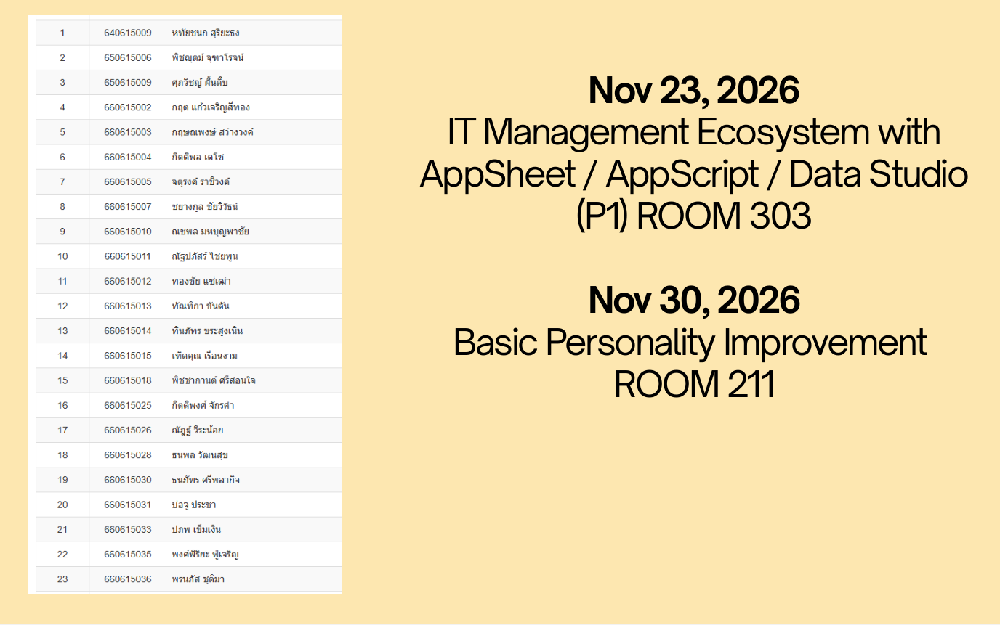
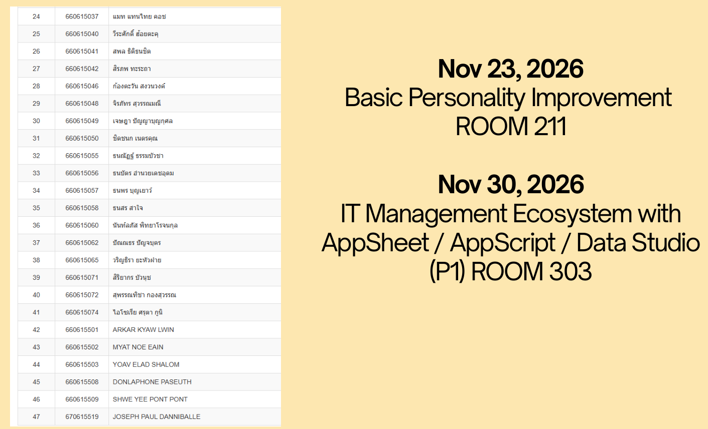

# Information

- 259192 - Skills for Professionalism and Entrepreneurship
  - Term 2569/2
- Instructor: Asst. Prof. Dr. Nirand Pisutha-Arnond
  - Department of Industrial Engineering, Faculty of Engineering, Chiang Mai University

# Resources

- [Youtube Playlist](https://www.youtube.com/playlist?list=PLehq6uu-A6wA)

# Attendance

> You will make 2 attendances.

- One for the beginning of the class for attending
- One after you complete the activity

# Roster (Nov 23)

# Roster (Nov 30)

