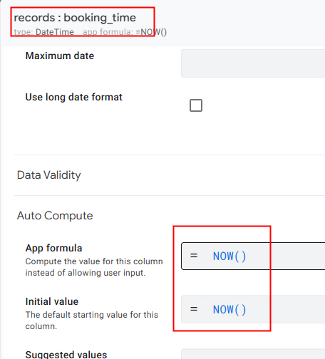
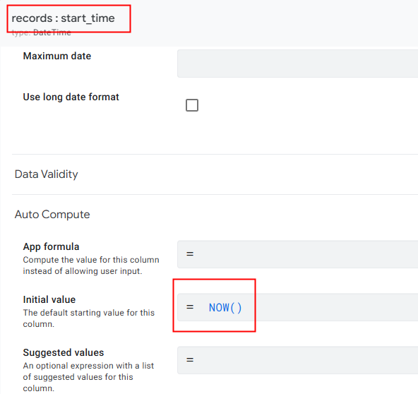
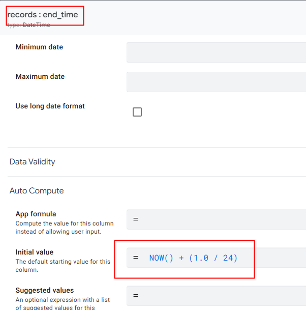
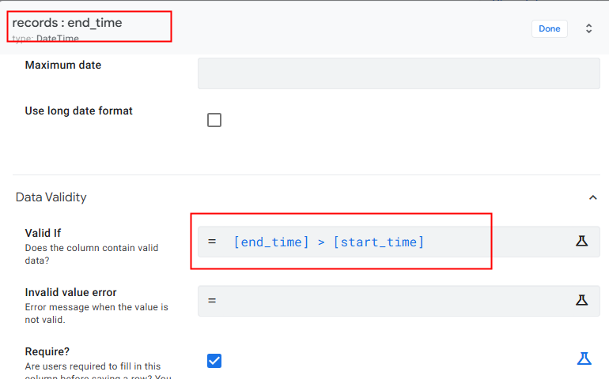
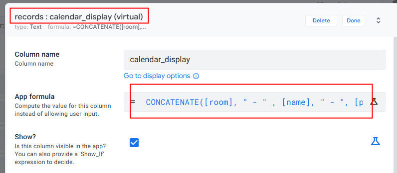

# `type`, `key` and `label` columns


# Room enum


# `booking_time` column

```
NOW()
```



# `start_time` and `end_time` columns

```
NOW() + "001:00:00"
```

- `start_time`
  

- `end_time`
  

# Data validation for `end_time` column

```
[end_time] > [start_time]
```



# `calendar_display` Virtual column

```
CONCATENATE([room], " - " , [name], " - ", [purpose])
```


