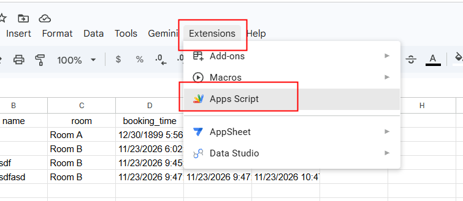
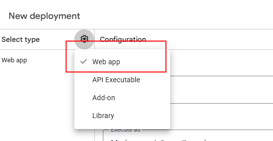
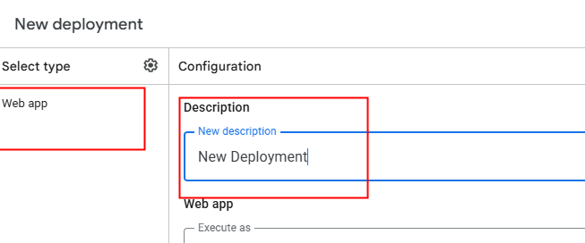

# AppScript

- [Code to send email notification](https://gist.github.com/nnnpooh/09f577c7fd44ea2f633d978e8f0846c7#file-appscript_email-js)

# Access AppScript

> It is recommended to access AppScript through the Google Sheet `Extensions` menu.

---

# Code Snippets

---

# Trigger

---

# Deployment

- Choose Web App

---

- Type Description

